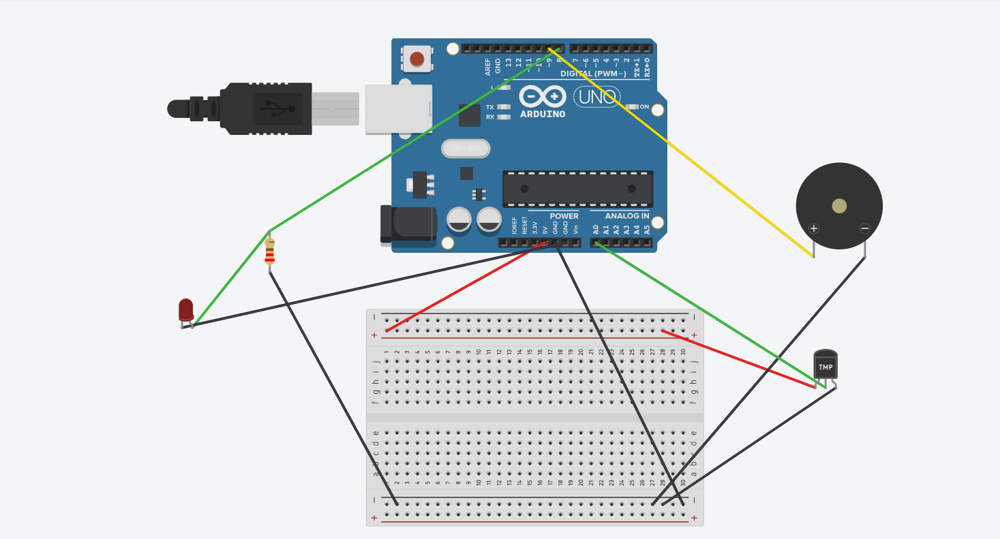
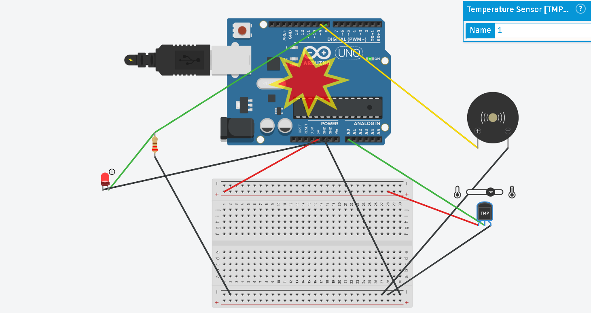

# Smart_Temperature_Alert_Tinkercad
Smart Temperature Monitoring &amp; Multi-Modal Threshold Alert System simulated in Autodesk Tinkercad using Arduino Uno R3, TMP36 sensor, Red LED, and Piezo Buzzer
# CodeAlpha IoT Internship — Task 2: Smart Temperature Monitoring & Alert System

**Intern Name:** Chaitanya Jaydas Patil  
**Domain:** Internet of Things (IoT)  
**Live Tinkercad Simulation:** [Open Interactive Circuit](PASTE_YOUR_TINKERCAD_LINK_HERE)  
**Deliverables:** [`Task2_Simulation_Report.pdf`](./Task2_Simulation_Report.pdf) | [`temperature_alert.ino`](./temperature_alert.ino)  

## Abstract
Continuous thermal monitoring is essential across server infrastructure, cold-chain logistics, greenhouses, and smart environments to prevent overheating hazards. This project presents the design, embedded C++ firmware development, and virtual verification of an automated IoT edge-sensing node built in Autodesk Tinkercad Circuits using an Arduino Uno R3 and an Analog Devices TMP36 solid-state temperature sensor. The microcontroller samples analog voltage via its 10-bit ADC (`Pin A0`), computes ambient temperature in degrees Celsius, streams live telemetry over UART serial (`9600 baud`), and triggers synchronized visual (`Red LED on D8`) and audible (`1 kHz Piezo Buzzer on D9`) alarms whenever temperature exceeds `30.0°C`.

## Simulation Verification
| Normal State (< 30°C) | High-Temperature Alert (> 38°C) |
| :---: | :---: |
|  |  |
